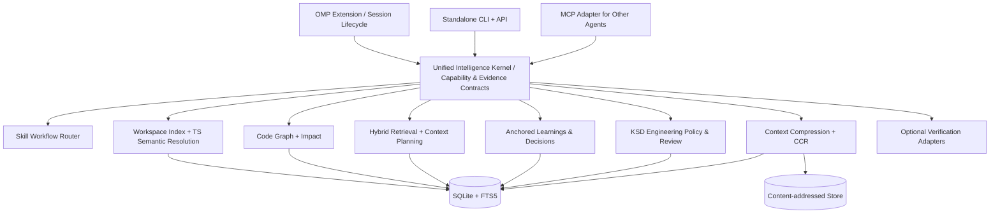

# Engineering Intelligence — Complete Knowledge Transfer & Implementation Handoff

> **Snapshot:** 2026-11-08 (Asia/Bangkok)  
> **Owner/project context:** Private/personal Engineering Intelligence Library for Oh My Pi (OMP), intended to be owned and controlled by the user. Public release remains undecided.  
> **Document status:** KNOWLEDGE EXPORT / DESIGN & PARTIAL IMPLEMENTATION EVIDENCE — **not** a statement that the unified system is built or production-ready.  
> **Coverage:** This document exports the known project-specific conversation decisions, previously recorded technical research, source references, verified local prototype results, owned plugins, target architecture, migration/workflow, risks, and next implementation steps. It does **not** dump unrelated personal history or private credentials.

---

## 0. Read this first: verified vs. proposed

**What demonstrably exists:**

1. An **owned engineering plugin** at [`Krisada-M/ksd-engineering`](https://github.com/Krisada-M/ksd-engineering); its `main` README was fetched through the connected GitHub tool in this conversation. It describes **KSD Engineering Proxy v0.6.0** with policies, commands, scope precedence, changed-line checks and OMP status integration. These are **repository claims/docs**, not a fresh live-OMP E2E test in this session.
2. An **owned Visual QA/UI comparison project** at [`Krisada-M/visual-qa`](https://github.com/Krisada-M/visual-qa). Its fetched README identifies the project as **uiMatch**, a Figma↔implementation visual-diff and quality-gate tool. README declares experimental `0.x` APIs.
3. A **local Skill Workflow Router prototype** at `/mnt/data/ei-skill-router/` and archive `/mnt/data/ei-skill-router-prototype.zip`, version `0.1.0`, Node.js >=20, no runtime dependencies. On **2026-11-08**, `node --test` was executed again and **8/8 tests passed**, 0 failed, approximately **112 ms** elapsed in this container. The test scope is offline unit tests and a **mock OMP adapter**, *not* live OMP or real upstream skill checkouts.
4. A substantial earlier **research/design document** titled *แผนสร้าง `engineering-intelligence` สำหรับ OMP ให้ใช้งาน Production ได้จริง* (743 lines) was located in the user Library and consulted. It provides an implementation plan and estimated targets, **not completed production implementation**.
5. A Deep Research request was submitted regarding the seven upstream projects and real-world integration. **Submission/start does not equal completed research findings or validated implementation.**

**What does not yet exist as a verified complete product:** unified code intelligence kernel, owned semantic graph/index, real OMP integrated skill workflow, context-aware reversible compression engine, knowledge store, production policy engine, end-to-end agent benchmark, published `ei` package, or completed migration of all plugins. No source code from the seven upstreams was merged into an owned package here. No merge, push or deploy was executed in this conversation.

**Evidence vocabulary for everything below:**

- **VERIFIED IN THIS SESSION** — command/tool actually executed and its result observed.
- **REPO-DOCUMENTED** — seen in upstream or owned project README/source notes, but not retested end-to-end here.
- **PRIOR RESEARCH** — derived from previously saved research/analysis, require reconfirmation at pinned SHAs before implementation.
- **DESIGN DECISION** — agreed/recommended system behavior, not written code.
- **PROPOSED TARGET** — numerical acceptance threshold or architecture goal, not a measured result.
- **UNKNOWN / NOT VERIFIED** — missing evidence or open question.

---

## 1. Product vision and non-negotiable user requirements

Build **one owned and distributable library/product**, *not* merely a wrapper that runs seven other plugins:

- Core code should be independently maintained and comprehensible, with clear source ownership.
- It should be installed once and be usable with OMP as the primary host. Also provide a standalone CLI and, where worthwhile, an MCP adapter for other agents.
- It should improve the coding workflow across **requirements → investigation → impact/context → implementation → verification → review → delivery** without recreating the OMP agent runtime.
- It should retain the user's custom KSD Engineering Policy and integrate external skill know-how from **Matt Pocock, poteto/pstack, and Addy Osmani**.
- It should leverage the work already done in **Headroom, Caveman, Ponytail, GitNexus, CodeGraph, CGC, and Graft/Trail-Code**, but inspect licenses carefully and avoid unlicensed source reuse.
- It must be **usable in a real codebase** (primarily TS/JS monorepos, Next.js, Hono, React Native, SQL, payments/auth workflows), not just runnable as a toy demo.
- Correctness takes precedence over token savings. Graph and impact results must say **UNKNOWN/PARTIAL** when evidence is incomplete rather than making misleading low-risk claims.
- Minimize unnecessary dependencies, subprocesses, always-on indexing, duplicate auto-routers, redundant hooks, cost, memory and latency.
- Preserve exact source, errors, logs and irreversible evidence where correctness depends on them; be able to recover lossy-compressed originals byte-for-byte.
- All structural analysis should work without an LLM by default. LLM-generated recommendations must be distinguishable from deterministic proof.
- Existing OMP provider routing/model roles, tool approval and sessions remain OMP-owned.
- Do not silently disable security, relax tests, migrate production DBs, merge, deploy, or replace existing plugins before acceptance gates and rollback are verified.
- Prefer small focused TypeScript files, separation of concerns and an extensible but simple implementation over microservices/overengineering.
- **Release model:** Private-first was once recommended, but the latest design concluded that choosing Public vs Private is **not a prerequisite** to a local proof-of-value. License constraints apply in both cases.

### What success means

A user can request e.g. `Fix recurring payment lifecycle` in OMP and the system:

1. Classifies task and risk, selects relevant **leaf skills** without prompting three auto-routers.
2. Ensures code index is fresh for staged, unstaged and untracked changes.
3. Locates exact symbols, routes, callers/callees, tests, public contracts and impact paths with provenance.
4. Builds an appropriately sized context pack before considering compression.
5. Applies KSD style and risk-scaled engineering policy without overwhelming every turn.
6. Runs or proposes relevant quality gates via safe adapters, collecting actual pass/fail/skip evidence.
7. Reports uncertainty, unverified integration, residual risks, and what was changed.
8. Can be disabled without breaking the original OMP workflow.

The acceptance definition is based on **task correctness, real runtime integration, measured token/cost/latency, and safe rollback**, not successful package installation alone.

---

## 2. Reference projects — what each contributes

| Project | Official/working reference | Unique lessons worth extracting | Proposed role | Evidence/constraint |
|---|---|---|---|---|
| **Headroom** | https://github.com/headroomlabs-ai/headroom | Content routing, tool-output optimization, cache-aware compression, **CCR** (reversible retrieval of originals), compression stores | Context/Compression design reference | Apache-2.0 reported; check pinned source and NOTICE |
| **Caveman** | https://github.com/JuliusBrussee/caveman | Structured output compression, detect → transform → validate → store → emit, fail-safe output handling | Compression safety behavior reference | Split license; engine-linked areas reported **BSL-1.1**, not universally MIT |
| **Ponytail** | https://github.com/DietrichGebert/ponytail | YAGNI, scope minimization, caller inspection, review heuristics, trust boundary discipline | Policy & review rules | MIT reported; not equivalent to a compiler/static analyzer |
| **GitNexus** | https://github.com/abhigyanpatwari/GitNexus | Knowledge graph traversal, process-aware impact, completeness/uncertainty guardrails, discovery UI/MCP patterns | Behavioral design reference for risk semantics | **PolyForm Noncommercial 1.0.0** reported; do **not** transplant implementation into commercial-capable owned core without proper rights |
| **CodeGraph** | https://github.com/colbymchenry/codegraph | Tree-sitter extraction, SQLite/FTS5, reference resolution, incremental `sync()`, graph traversal | Primary code index/storage reference | MIT reported; candidate for careful reuse versus independent implementation |
| **CGC / CodeGraphContext** | https://github.com/CodeGraphContext/CodeGraphContext | Tree-sitter + optional SCIP, calls/relations, GraphWriter, multi-language regressions | Precision/regression reference | MIT reported; optional semantic overlay, not required DB server |
| **Graft / Trail-Code** | https://github.com/trailhq/Trail-Code | Code maps, working-tree freshness, content-hash caches, repository learnings/decisions | Knowledge/freshness reference | MIT reported; Graft's evolution/name should be revalidated at pinned revision |
| **Oh My Pi (OMP)** | https://github.com/can1357/oh-my-pi | Extension hooks, custom tools/commands, skills, session context, model/provider orchestration | Host platform; *not* to be reimplemented | Extension API compatibility must be tested on installed OMP version |

**Identity caveat:** multiple repositories/products share names such as “CodeGraph” or “Graft.” The links above are the working project identification from the discussion and research. Confirm each SHA, version and package before any reuse or benchmark. Never silently substitute a similarly named project.

### Important corrections to early architectural assumptions

- **Headroom is not a long-term memory system by itself**; its main relevant role here is context/tool-output optimization and CCR.
- **Caveman is not a full SDLC orchestrator**; the relevant overlap with Headroom is content/output compression.
- **Ponytail is not SonarQube/Semgrep**; it provides simplification/review behaviors, not a comprehensive static analyzer.
- **Graph is not everything**: code relations are a graph; text, original blobs, state, learnings and compression caches need other storage models.
- **Tree-sitter is not a full TS semantic compiler**: rely on the TypeScript Language Service for TS/JS symbol resolution.
- **Never classify no callers as safely unused**; dynamic dispatch, runtime imports, reflection, framework wiring and cross-language invocation create coverage gaps.
- **Do not assume combining tools improves performance**. Multiple parsers, context injectors and review loops can worsen speed and answer quality.

### Reuse/license decision matrix (must be reverified)

| Category | Policy |
|---|---|
| Permissive MIT/Apache code | Reuse **only when justified**; preserve license/notice, attribution and provenance; audit transitive dependencies |
| GitNexus PolyForm Noncommercial | Behavioral research only for a commercial-capable core; do not copy code or assume private repo exempts restrictions |
| Caveman BSL-1.1 sections | Prefer independent safety contracts/implementation unless applicable BSL rights or separate license are established |
| Skill Markdown from Matt/poteto/Osmani | **Load from pinned, reviewed upstream checkout** initially; do not bundle/copy until each repository/content license and transitive files are checked |
| User-owned KSD/UI tooling | Keep original ownership and original compatibility contracts; migration should be verified separately |

Prior research points to important source paths (these are *audit targets*, not proof that paths are unchanged now):

- Headroom: `headroom/compression/universal.py`, `headroom/ccr/tool_injection.py`, `headroom/cache/compression_store.py`, `headroom/proxy/handlers/*`.
- Caveman: `engine/`, `engine/compressors/`, `LICENSING.md`, `LICENSE.BSL`.
- Ponytail: `skills/ponytail/SKILL.md`, `AGENTS.md`, benchmark material.
- GitNexus: `gitnexus/src/cli/index.ts`, `gitnexus/src/mcp/tools.ts`, `GUARDRAILS.md`.
- CodeGraph: `src/index.ts`, `src/db/schema.sql`, extraction/resolution/search/graph modules.
- CGC: `src/codegraphcontext/tools/tree_sitter_parser.py`, `tools/languages/*`, indexing writer/schema, SCIP paths.
- Trail: `src/ask/ask.ts`, graph build/write, `.trail/learnings`, AI synthesis modules.
- OMP: `docs/extensions.md`, `docs/skills.md`, extension-source/lifecycle docs.

Before production development: clone, pin immutable SHAs, generate a manifest per upstream, inspect LICENSE/NOTICE for each directory, record `reuse/adapt/behavior-only/blocked` classification, and keep `research/upstream/*` + `LICENSE_MATRIX.md` in the repository.

---

## 3. Previously owned work: KSD Engineering Proxy

**Repository:** https://github.com/Krisada-M/ksd-engineering  
**OMP marketplace plugin:** `engineering-proxy@engineering-proxy`  
**Main README observed in this session:** `KSD Engineering Proxy for OMP (v0.6.0)`  
**Status:** REPO-DOCUMENTED; runtime on current personal OMP **not tested** in this session.

### Existing behavior and design boundaries

- Personal engineering style: balanced/adaptive, readable TS, guard clauses, flatten nesting, avoid nested ternaries, strong types, explicit error handling, small helpers, comments for **why** not obvious what.
- Existing “blank-before-return” style has nuance: v0.6.0 no longer requires a blank line with only one preceding statement.
- Two-tier prompt approach: small per-turn KSD style policy (README says approx. **430 tokens**, down from ~950) plus larger SDLC review via explicit `/engineering-review`.
- Risk-scaled SDLC: Requirements → Design → Implementation → Verification → Delivery; stricter gates for payments, auth/security, migrations and concurrency.
- Does not itself execute tests, merge, deploy or automatically launch Ponytail review.
- **Scope precedence:** `session override > project config > global config > built-in balanced` for enforcement mode; `enabled` merges separately (project overrides global).
- Global file: `~/.omp/agent/engineering-proxy.json`.
- Project file: `<repo>/.engineering-proxy.json`, nearest `.git` or `.omp` project root.
- Session persistence via OMP custom entries; invalid config causes fail-open **policy injection disabled**, not destructive overwrite.
- OMP/TUI indicator `○ 🛡 KSD: BALANCED` or `● 🛡 KSD: ADAPTIVE` indicates agent activity/mode **not quality gate PASS**.
- Existing changed-line ESLint utilities: `eslint-rules/index.js`, `change-scope.js`, `check-changed.js`; zero-context diff and ESLint JSON report; untracked files are not included by a plain Git diff against `HEAD`.
- Runtime design: strict TS core compiled to checked-in ESM; `index.js` OMP entrypoint imports it, no per-event subprocess, caching and deduplicated status updates.
- Ownership contract: **KSD** owns style/evidence/boundaries, **Ponytail** owns simplification review, **repository** owns linter/tests/architecture conventions, **OMP** owns agent orchestration and permissions.
- KSD deliberately does **not** mutate Ponytail state, call Ponytail automatically, or override OMP's built-in REVIEW indicator.
- Historical KSD experiments included Rust-vs-TS evaluation; the reported decision was keep TS runtime and not merge a Rust rewrite.

### KSD commands currently documented

```text
/engineering-proxy
/engineering-proxy status
/engineering-proxy adaptive
/engineering-proxy balanced
/engineering-proxy reset
/engineering-proxy global adaptive
/engineering-proxy global balanced
/engineering-proxy global reset
/engineering-proxy repo adaptive
/engineering-proxy repo balanced
/engineering-proxy repo reset
/engineering-review [scope]
```

### KSD installation from repository README (documentation only)

```bash
omp plugin marketplace add Krisada-M/ksd-engineering
omp plugin install engineering-proxy@engineering-proxy
omp plugin list
```

To refresh an installed release, according to the README:

```bash
omp plugin marketplace update engineering-proxy
omp plugin upgrade engineering-proxy@engineering-proxy
omp plugin list
```

Restart and smoke-test OMP after upgrade; **do not claim a version is active from README alone**. Commands are captured for handoff, not executed in this session.

### KSD local validation commands documented by its README

```bash
npm ci
npm run lint
npm run build
git diff --exit-code -- plugins/engineering-proxy/dist/
npm test
node plugins/engineering-proxy/test/benchmark.mjs
```

Prior progress notes reported earlier passing suites (e.g. 45/45, 68/68, 75/75 across different commits/releases), but these are **historical context**, not current CI proof. The README labels the synthetic benchmark as **illustrative and not live-OMP latency**. Several previous plans explicitly left Mac/Ponytail mode-switch integration unverified.

### Migration requirement

**Do not rewrite away KSD behavior.** First capture contract/golden tests for commands, scope precedence, overrides/reset tombstones, config failure modes, TUI indicator ownership, persistence, policy injection limits, and changed-line checks. Then factor KSD policy into the unified library **behind a compatibility adapter**. Existing command names and config semantics must remain stable unless explicitly approved.

---

## 4. Previously owned work: Visual QA / uiMatch

**User-owned repository:** https://github.com/Krisada-M/visual-qa  
**README describes:** `uiMatch` visual fidelity tooling; docs refer to public packages and an upstream `kosaki08/uimatch` namespace. Verify actual repo lineage, package namespace, maintained branch and publishing ownership rather than assuming the GitHub repo name equals the npm package name.  
**Status:** REPO-DOCUMENTED; visual end-to-end tests were **not rerun** here.

### Observed capability

- Capture implementation using Playwright and compare to a Figma node.
- Diff pixels, layout, styles, colors (including ΔE2000), and text.
- Emit Design Fidelity Score / configurable quality gates, image artifacts `figma.png`, `impl.png`, `diff.png`, structured `report.json`.
- CLI `compare` and `suite`; documented exit statuses `0` pass, `1` mismatch, `2` argument/config error.
- Research/evals harness explores agent feedback/repair loops, but README explicitly calls this experimental, *not* a public autonomous repair CLI.
- Potential ecosystem adapters: Figma/Figwright, Playwright, ODiff, SonarQube, Semgrep, Ruff, BasedPyright, Reviewdog, Trivy and other existing checks.

### Documented example (do not assume already configured)

```bash
npx @uimatch/cli compare \
  figma='<fileKey>:<nodeId>' \
  story='http://localhost:6006/iframe.html?id=button--primary' \
  selector='#storybook-root button' \
  outDir='./uimatch-reports'
```

**Why adapter, not core:** Browser lifecycle, screenshots, authentication, image processing, external Figma access and heavy dependencies should not burden every code-intelligence query. Model the integration as an **optional evidence-producing verification adapter**. Long-term usability goal: infer/resolve a compare plan from task and repo configuration without requiring the user to hand-edit `case.json` each time; never guess authenticated state or fabricate score.

---

## 5. Skills and workflow: Matt Pocock, poteto/pstack, Addy Osmani

### Upstream skill references

- Matt Pocock: https://github.com/mattpocock/skills
- poteto/Lauren Tan: https://github.com/cursor/plugins/tree/main/pstack
- Addy Osmani: https://github.com/addyosmani/agent-skills
- OMP skills: https://github.com/can1357/oh-my-pi/blob/main/docs/skills.md
- OMP extension authoring: https://github.com/can1357/oh-my-pi/blob/main/docs/skills/authoring-extensions.md

### Philosophy and ownership

- Have **exactly one automatic skill router**. Disable or avoid stacking other automatic meta-routers (`poteto-mode`, `using-agent-skills`, `ask-matt`) when this one is active; still permit direct user-invoked skills.
- **KSD + explicit owner decisions + repository policy outrank external skill instruction text.** Skills cannot authorize dangerous actions.
- Select **one primary leaf skill per task/stage** and optionally one independent high-risk review/verification skill.
- Skills are **instructions/resources**, not verified executors: loading `SKILL.md` is not equivalent to executing or validating a workflow.
- Load from trusted roots, pin SHAs and content hashes, validate referenced scripts and dependencies, enforce prompt budget and trace provenance.
- Treat skill Markdown as untrusted input until reviewed: it can contain prompt injections or instructions incompatible with OMP.
- Stage changes and approval decisions must be explicit and auditable; manual skill overrides should be possible.

### Proposed adaptive SDLC stages

| Stage | Purpose | Example skill source | Required evidence/output |
|---|---|---|---|
| `plan` / Understand | Requirements, constraints, scope, AC | Matt or Addy | Acceptance criteria and bounded design |
| `investigate` | Root cause, callers, relevant changes | Matt / poteto `how`,`why` | Reproduction, evidence, impact |
| `implement` | Focused changes, TDD where appropriate | Matt or Addy | Small diff, test additions |
| `verify` | Focused checks, security/performance as needed | Addy | Actual command outputs, failures/skips |
| `review` | Blast radius, simplicity, adversarial review | poteto + KSD/Ponytail | Findings and residual risk |
| `ship` | Delivery readiness | Addy | Release prerequisites, user approval, rollback |

These are **candidate routes**, not six mandatory skill calls per task. Small tasks may skip stages; risky auth/payment/DB work needs stricter gates. Do **not** call an LLM skill merely to satisfy a ceremony.

### Prototype implementation: what is real

**Current extracted files:**

```text
/mnt/data/ei-skill-router/
├── README.md
├── package.json
├── src/
│   ├── catalog.mjs
│   ├── cli.mjs
│   ├── engine.mjs
│   └── router.mjs
├── omp/
│   └── extension.mjs
└── test/
    └── router.test.mjs
```

- `catalog.mjs` has **15 allowlisted** leaf skill IDs with explicitly configured relative `SKILL.md` paths.
- `router.mjs` classifies English keyword tasks into `bug`, `feature`, `refactor`, `security`, `performance`, `ui` and requires one of `plan`, `investigate`, `implement`, `verify`, `review`, `ship` with `normal|high` risk.
- High risk verification adds `osmani:security-and-hardening` when it is not already selected; high-risk review adds `poteto:blast-radius` when not already selected.
- The router always returns `mayMerge:false` and `mayDeploy:false`.
- `engine.mjs` loads real SKILL.md files **only** from explicit absolute trusted roots, canonicalizes paths, blocks escapes via symlink, checks regular files and a 64 KiB size cap, requires YAML frontmatter, and returns original source path/provenance.
- `prepareWorkflow({strict:true})` fails on missing skills. `renderWorkflow()` includes KSD/owner precedence and never executes a skill's scripts.
- `omp/extension.mjs` registers the experimental **read-only** `ei_workflow` tool and delegates to `prepareWorkflow`; it has been **mock-tested**, not verified on installed OMP.
- The categorizer currently relies on **English keywords** and defaults unknown language/task types to feature, so a Thai-language classifier is a known limitation.
- High-level route **does not** itself perform SDLC state transitions, code analysis, tests, tool permission enforcement, provider verification or runtime behavior assessment.

**Observed test execution, 2026-11-08:**

```text
node --test
# tests 8
# pass 8
# fail 0
# cancelled 0
# skipped 0
# duration_ms 112.18931
```

The tested cases were: bug diagnosis without router recursion, high-risk blast-radius once, high-risk verification without deploy permission, invalid stages/tasks, missing skill fail-closed, trusted-root read, symlink escape, and mock OMP registration/error.

**Prototype commands** (route/test actually runnable; `load` requires upstream checkouts):

```bash
cd /mnt/data/ei-skill-router
node --test
node src/cli.mjs route --task 'fix recurring payment race condition' --stage investigate
node src/cli.mjs load --task 'fix recurring payment race condition' --stage investigate
node src/cli.mjs route --task 'auth vulnerability' --stage verify --risk high
```

**Upstream checkout example** from the prototype README (not executed in this session):

```bash
mkdir -p "$HOME/ei-skill-sources" && cd "$HOME/ei-skill-sources"
git clone https://github.com/mattpocock/skills.git matt
git clone --filter=blob:none --sparse https://github.com/cursor/plugins.git cursor-plugins
(cd cursor-plugins && git sparse-checkout set pstack)
git clone https://github.com/addyosmani/agent-skills.git osmani
export EI_MATT_ROOT="$HOME/ei-skill-sources/matt"
export EI_POTETO_ROOT="$HOME/ei-skill-sources/cursor-plugins/plugins"
export EI_OSMANI_ROOT="$HOME/ei-skill-sources/osmani"
```

Pin each checkout to reviewed SHAs; inspect pstack's Cursor-specific subagents/actions (may not be OMP-compatible). Verify all catalog relative paths: no upstream compatibility was established during the local unit-test run.

**Experimental OMP invocation** (not live-tested here):

```bash
omp --extension ./omp/extension.mjs
```

**Next work:** define robust structured routing API, Thai/multilingual labels, repo-context classification, prompt-budget caps, recursion prevention, explicit user triggers/overrides, per-skill dependency graph, source SHA/hash validation, skill sandbox boundary, route correctness evals and live OMP E2E.

---

## 6. Revised target architecture: one product, multiple coherent modules

**Final preferred direction:** a **Modular Intelligence Kernel** that does not rebuild OMP or run 7 upstream tools through wrappers; **one install/package, one host integration, one config**, with internal modules and optional adapters.



**Important:** shared infrastructure does **not** mean a single graph schema for all data. Source text, compression originals, temporal events, learning assertions and code edges have different correctness/invalidation needs.

### Chosen technology defaults / trade-offs

| Area | Preferred starting point | Reason / boundary |
|---|---|---|
| Language | **TypeScript**, small cohesive modules | Native with user’s stack and OMP integration; simplify maintenance |
| Runtime | Node-compatible ESM; Bun permitted | Avoid unnecessary Bun-only lock-in |
| Source discovery | Git-aware working-tree scanner | See uncommitted/untracked files; respect ignore/exclusions |
| TS/JS semantics | **TypeScript Language Service** | Resolve aliased symbols, re-exports, project refs, overloads |
| Multi-language structural parsing | **Tree-sitter**, staged | Cheap syntax extraction; not the semantic authority for TS |
| Optional precision | LSP/SCIP indexer adapters | Add when a supported language or accuracy gap justifies it |
| Local storage | **SQLite + FTS5**, WAL, migrations | No required graph database server |
| Large source/CCR originals | Content-addressed blob store | Byte-exact retrieval, checksum, atomicity |
| Retrieval | Lexical BM25/FTS5 + graph/path/test rerank | No vector DB in V1; instrument missed recall |
| Agent communication | Native OMP extension first, MCP optional | Avoid needless JSON-RPC in hot path |
| Workflow | Single router + KSD policies + opt-in skills | Prevent duplicated prompt injection and conflicting routers |
| Quality | Existing test/lint/visual/security tools as adapters | Do not reinvent mature analyzers |
| Rust | Defer until profiling evidence | Preserve simple deployment until performance proof demands it |
| LLM | Optional for inference/synthesis | Deterministic indexing, graph/evidence must not require it |

### Proposed single-package repository layout

```text
engineering-intelligence/
├── src/
│   ├── kernel/                 # Contracts, capabilities, errors, task orchestration
│   ├── workspace/              # Discovery, fingerprint, freshness
│   ├── indexing/               # Full/incremental index, TS LS, Tree-sitter
│   ├── resolution/             # Exports, imports, names, framework patterns
│   ├── graph/                  # Edges, callers/callees, impact traversal
│   ├── retrieval/              # FTS/BM25, ranking, context pack
│   ├── compression/            # Classifier, lossless/lossy + CCR store
│   ├── knowledge/              # Anchors, decisions, freshness, approval
│   ├── evidence/               # Provenance, completeness, revisions
│   ├── policy/                 # KSD style, risk gates, review rules
│   ├── workflow/               # Skills catalog/router/loader/stage engine
│   ├── verification/           # Adapter contracts + evidence
│   ├── storage/                # SQLite migrations, CAS
│   ├── adapters/
│   │   ├── omp/                # Native extension
│   │   ├── mcp/                # Optional interop
│   │   └── cli/                # ei CLI
│   └── index.ts
├── tests/
│   ├── fixtures/
│   ├── golden/
│   ├── integration/
│   ├── regression/
│   └── fuzz/
├── benchmarks/
│   ├── corpus/
│   ├── tasks/
│   ├── runners/
│   └── reports/
├── research/upstream/
├── docs/adr/
├── .github/workflows/
└── LICENSE_MATRIX.md
```

This is a **target layout**. There is no evidence that the unified repo directory or most of these files exist yet.

---

## 7. Semantic code indexing: correctness contracts

### Canonical data models (proposed)

Use relational indexed data and explicit revisions; represent graph edges with provenance rather than assuming a fully resolved map.

```sql
-- Indicative fields only; write actual SQL DDL and migrations before release.
files(id, path, language, content_hash, size, git_blob_hash,
      indexed_at, parser_version)

symbols(id, file_id, stable_key, name, kind,
        start_byte, end_byte, start_line, end_line,
        signature_hash, body_hash)

edges(id, src_symbol, dst_symbol, kind,
      confidence, resolver, evidence_id, revision_id)

evidence(id, source_type, file_id, start_byte, end_byte,
         extractor, extractor_version, confidence, notes)

revisions(id, workspace_fingerprint, git_head, dirty_hash,
          created_at, completeness_status)

learnings(id, scope, title, body, anchor_type, anchor_key,
          source, created_at, reviewed_at, stale_state)

ccr_objects(hash, codec, original_bytes, original_tokens,
            compressed_tokens, created_at, expires_at)
```

**Add proper FK constraints, transaction boundaries, index scans, versioning and migration tests** in actual DDL. Do not store user-approved long-term knowledge exclusively in a regenerateable code index.

### Full index pipeline

```text
repo/workspace discovery
→ hash file contents (not mtime only)
→ classify language and exclusions
→ structural parse
→ declarations/imports/call sites
→ TS compiler-grade symbol resolution (supported TS/JS)
→ evidence-bearing edges
→ write staging revision transactionally
→ run file census + edge/symbol integrity checks
→ publish active revision atomically
```

### Incremental index contract

- Changed file: drop/rebuild affected declarations, references and outgoing edges; invalidate incoming edges if export surface or symbol identity changed.
- `mtime` alone is inadequate: rely on content hashes/dirty fingerprints.
- `ensureFresh(scope)` should run before sensitive queries; watchers are an optimization, **not** correctness authority.
- Update staged, unstaged and untracked filesystem content where within indexed scope.
- No partial graph should be published as complete if parser errors, file census collapse, unresolved rate spikes, schema/hash issues, worker crashes or broken revision transactions occur.
- No stale edges after rename, re-export change, file removal, tsconfig path change or project-reference change.
- The golden rule: **canonicalized incremental graph == full rebuild** after supported mutations.

### TS/JS resolution must include

Re-exports and barrel files; `paths`/`baseUrl`; workspace packages; ESM/CJS where supported; `tsconfig` project references; aliases; inherited methods; overloads; generics/type-only imports; interface dispatch; callbacks; methods via property access; route registries/framework patterns. Explicitly identify unsupported runtime/dynamic patterns instead of guessing.

Proposed evidence strength enum:

```ts
type EvidenceStrength =
  | 'compiler'
  | 'syntax-exact'
  | 'scope-resolved'
  | 'heuristic'
  | 'unknown';
```

Useful semantic edge kinds: `CALLS`, `REFERENCES`, `IMPORTS`, `EXTENDS`, `IMPLEMENTS`, `CONSTRUCTS`, `READS`, `WRITES`, `ROUTES_TO`, `TESTS`. Provenance should include file span, version, resolver, parser version and revision identity.

### Impact analysis rule

```text
resolve exact target or require disambiguation
→ traverse hard semantic incoming edges (BFS by depth)
→ collect related route/config/test boundaries
→ annotate each path with provenance + freshness
→ assess completeness, unsupported dynamics, ambiguity
→ return risk HIGH/MEDIUM/LOW/CRITICAL/UNKNOWN
```

**LOW is permissible only when the supported graph is sufficiently complete.** Zero static callers **does not** prove low risk. Unsupported dynamic dispatch/bridges must yield UNKNOWN/PARTIAL with concrete reasons and optional paths.

### Retrieval/context planning

Preferred initial ranking:

```text
BM25/FTS5 lexical relevance
+ exact symbol match
+ path or package match
+ graph proximity / caller-callee relevance
+ test adjacency
+ recent working-tree edit signal
+ anchored learning relevance
- stale revision penalty
- heuristic/unresolved edge penalty
```

Start **selection-first**: retrieve and select only relevant files/spans. Compress subsequently if still over budget. Embeddings/vector search are an optional future addition **only if measured semantic-recall gaps warrant it**.

### Failure modes from prior research to convert into regression fixtures

- Typed Python parameter extraction loss (prior CGC regression research reported a case of ~40% loss for a parser version).
- Go grouped imports not parsed in certain implementation paths.
- Native Tree-sitter query worker concurrency and reported SIGSEGV.
- Incomplete file census/changed export surfaces causing missing graph relations.
- Re-exports, aliases and dynamic calls silently treated as zero dependencies.

These are **historically reported upstream examples**, not an assertion that current upstream versions still have the same bugs.

---

## 8. Context optimization and CCR: safety before savings

### Goals

- Reduce unnecessary tool-output/context usage without losing actionable errors, security data, source-code semantics or exact evidence.
- Be aware of the model/provider's **prompt cache**; changing a stable prefix may cost more than a purported compressed token saving.
- Prefer structured pruning/selection and reversible handles over lossy recaps.
- Do not insert another always-on proxy or override existing OMP compression without A/B evidence.

### Compression contract (proposed)

```ts
interface CompressionResult {
  visible: string;
  originalHash?: string;
  originalBytes: number;
  originalTokens: number;
  visibleTokens: number;
  reversible: boolean;
  strategy: string;
  sourceRevision?: string;
}
```

### Safe compression transaction

```text
classify payload (code, JSON, logs, diff, tool result, etc.)
→ select type-specific strategy
→ validate format invariants
→ measure tokens/benefit after compression
→ if not sufficiently smaller, pass original
→ for any lossy visible representation:
     persist exact original bytes
     commit/checksum the object
     verify retrieval availability
     emit compressed text + opaque retrieval handle
→ if store/retrieval/parse validation fails: pass original
```

**Exact-byte recovery** means full bytes, encoding and line endings — not “summarized content looks similar.” Retention/LRU must not delete objects while an active session still references them. Do not expose compressed security secrets into logs/traces. Define per-provider cache boundaries before enabling injection.

### Recommended rollout

1. Tool-output **measurement** and provider cache baseline.
2. Read-only **context suggestions**.
3. Selection/ranking; no compression.
4. Lossless compressors with regression fixtures.
5. CCR with durable retrieval, corruption/failure tests and feature flag.
6. Optional lossy summarizers only for content classes with validated safe fallback.

No token-savings numbers or agent task-success improvements have been measured for our unified library.

---

## 9. Learnings, decisions, policy and review

### Knowledge design

Learnings must be *assertions with provenance*, not arbitrary summaries silently injected into later sessions. Suggested fields:

```yaml
id: retry-policy
scope: repo
anchor:
  symbol: packages/api/src/retry.ts#retry
claim: 'Payment retry count is intentionally 4.'
source:
  kind: user-confirmed
  commit: '<sha>'
status: active
review:
  required: true
```

**This YAML is an example, not a factual policy for any actual user project.**

Requirements:

- `user-confirmed`, `code-observed`, `test-verified`, `model-inferred` must not be conflated.
- Keep repo learnings reviewable and versionable; personal/local learning separate where needed.
- Track file/symbol anchors and compare against changes; `active → needs-review` on stale/missing signature, do not auto-inject stale claims.
- Make memory write opt-in or explicitly approved; never silently promote agent guesses into canonical decisions.
- Preserve source of decision and owner supersession; conflict detection is required.

### KSD + Ponytail policy design

- Existing KSD **mode and config precedence** remain authoritative.
- Ponytail-inspired rules should favor minimum sufficient diff, inspect callers/tests/config first, preserve validation, auth controls, accessibility and quality gates.
- Avoid wrapping every task in a verbose SDLC ceremony; use **risk-based verification** and existing project tooling.
- Deterministic lint/style findings must be distinguishable from model/skill review suggestions.
- A review finding must name file, span, issue, severity/confidence, evidence and whether verification actually ran.
- Never treat Ponytail `FULL`/`LITE` indicator or a policy status dot as test PASS.

### Adapters (default off until configured)

- `uiMatch`/Visual QA with Figma + Playwright.
- Figwright as Figma context/integration helper.
- ODiff for image difference when appropriate.
- SonarQube quality gate (report actual project/main/branch/gate config, don't infer PASS).
- ESLint, TypeScript checker, Vitest/Playwright, Semgrep, Ruff, BasedPyright, Reviewdog, Trivy/Gitleaks as *existing tools*.
- Adapter report should include: invocation, revision, host/environment, exit code, artifact pointers, timestamp, redaction, evidence, `PASS|FAIL|SKIPPED|ERROR|NOT_VERIFIED`.

---

## 10. API, CLI and OMP integration contracts

### Public TypeScript API — target, **not implemented**

```ts
export interface EngineeringIntelligence {
  open(root: string, options?: OpenOptions): Promise<Workspace>;
}

export interface Workspace {
  ensureFresh(scope?: FreshnessScope): Promise<FreshnessReport>;
  symbol(query: SymbolQuery): Promise<SymbolResult>;
  callers(query: GraphQuery): Promise<GraphResult>;
  impact(query: ImpactQuery): Promise<ImpactResult>;
  context(request: ContextRequest): Promise<ContextPack>;
  compress(input: CompressionInput): Promise<CompressionResult>;
  retrieve(hash: string): Promise<Uint8Array>;
  learn(input: LearningInput): Promise<Learning>;
  checkLearnings(): Promise<LearningHealth[]>;
  workflow(request: WorkflowRequest): Promise<WorkflowPlan>;
  verify(request: VerificationRequest): Promise<VerificationReport>;
  status(): Promise<WorkspaceStatus>;
}

export interface ImpactResult {
  target: ResolvedTarget;
  byDepth: ImpactNode[][];
  risk: 'low' | 'medium' | 'high' | 'critical' | 'unknown';
  completeness: {
    status: 'complete' | 'partial' | 'unknown';
    reasons: string[];
  };
  freshness: RevisionIdentity;
  evidence: EvidenceRef[];
}
```

The use of referenced types like `OpenOptions` is an **API design sketch**; they have not been declared or typechecked in a unified library.

### CLI — desired surface, **not available yet**

```bash
ei init
ei index .
ei sync
ei status
ei symbol createMembership
ei callers createMembership
ei impact createMembership --depth 4
ei search 'payment retry'
ei context 'fix recurring payment lifecycle' --tokens 12000
ei compress --type tool-output
ei retrieve '<hash>'
ei learn add ...
ei learn check
ei workflow route --task 'fix payment race' --stage investigate
ei doctor
ei benchmark
ei omp install
```

Do **not** mistake these proposed `ei` commands for verified commands. The only separately built working command surface in this conversation is the prototype's `node src/cli.mjs ...`.

### OMP adapter strategy

- Use OMP **Extensions**, not a fork of core/legacy hook rewrites.
- A thin native extension registers read-only tools such as `ei_symbol`, `ei_impact`, `ei_context`, `ei_retrieve`, `ei_learning`, `ei_workflow`.
- Hook lifecycle judiciously; inspect installed version's exact events/signatures before coding. Prior research considered `session_start`, `before_agent_start`, `context`, `tool_call`, `tool_result`, `agent_end`.
- Advisory intelligence must **fail open** so a temporary index failure cannot break the coding session.
- Destructive/security-sensitive gates can fail closed only under explicit scoped policy and authorized approval.
- Retain OMP-native permission boundaries; a skill or Markdown instruction cannot override approvals.
- Profile added latency and tool calls. Prefer in-process import/hot-path no subprocess; MCP optional for external clients.
- Feature flags and version pin allow a reversible migration.

### Conservative rollout configuration — design example

```yaml
engineeringIntelligence:
  enabled: true
  indexing:
    enabled: true
    freshnessOnQuery: true
  semantic:
    typescriptLanguageService: true
    lsp: false
    scip: false
  workflow:
    enabled: false  # until real OMP skills/adapter E2E
    autoRoute: false
  context:
    inject: false
  compression:
    enabled: false
    ccr: true
  policy:
    beforeEditImpact: warn
    afterEditImpact: warn
  learnings:
    enabled: false
    autoSave: false
  verification:
    visualQA: false
```

Rollout one change at a time: **read-only index → context suggestion → workflow routing → context injection → CCR → review/policy warnings → approved gates**. Never turn on new compression, injection and blocking hooks all at once.

---

## 11. Benchmark, acceptance gates and verification

**Correctness before optimization.** Do not use upstream promotional numbers as our measured results. Existing prior research includes example gains claimed by upstreams; those claims differ in models, task sets and methodology and must be independently benchmarked.

### Corpus

1. Synthetic but realistic TS monorepo: `apps/web`, `apps/api`, `packages/auth`, `payments`, `database`, `shared`, `ui`.
2. Real OMP repository integration corpus.
3. At least one medium TS monorepo with reproducible builds/tests.
4. A large repo for stress/performance (prior design suggested 5,000–20,000 source files).
5. Adversarial cases: path aliases, barrel exports, generic/overloaded functions, circular deps, cross-package/imports, callbacks, dynamic imports, routes, file move/rename/delete, codegen, dirty working tree, unsupported parser syntax, incomplete index and crash recovery.
6. Agent tasks for payment/auth/session/React UI/DB migration, with controlled baseline and task-success oracle.

### Proposed **targets**, not measured

| Metric | Proposed Level 3 gate | Important qualification |
|---|---:|---|
| TS definition precision | >=99.5% | Supported fixture set, corpus-defined denominator |
| TS definition recall | >=99% | Supported constructs only |
| Direct caller precision | >=98% | Golden annotation/oracle |
| Direct caller recall | >=97% | Golden annotation/oracle |
| Critical-impact false-negative rate | <1% | Test fixtures + explicit UNKNOWN coverage |
| Incremental/full graph equivalence | 100% | Canonicalized supported graph |
| Index stale detection | 100% | Mutation/dirty-tree fixtures |
| CCR exact-byte recovery | 100% | Including faults and restart/recovery |
| Medium-repo warm query p95 | ~100–150ms | Prior aspirational gate; must baseline hardware/runtime |
| Context tokens | >=25% median reduction | **Only if agent task success does not regress** |
| Agent success | >= controlled baseline | Repeat trials, confidence intervals, nontrivial tasks |

Numerical gates may need recalibration after corpus design. A successful unit test does not prove real integration; a synthetic p95 measurement is not live OMP performance.

### Verification stages

- **Level 1 — Working standalone:** supported CLI/API; graph/index/freshness/impact/retrieval/CCR; golden and failure-case tests pass.
- **Level 2 — OMP-capable:** real installed OMP extension smoke/E2E; route+code search+impact+context+test evidence; error isolation and explicit fallback.
- **Level 3 — Production-capable:** CI Linux/Windows/macOS, crash recovery, schema migration, dependency/license audit, measured agent A/B, soak testing on a real repository, tracing, disable/rollback drill.

### CI gates (planned)

```text
PR:
  dependency lock / license-SBOM checks
  typecheck + lint + unit tests
  golden index/symbol/graph tests
  incremental-vs-full equivalence
  DB migration + corruption/failure tests

main:
  above + integration corpus
  real OMP adapter smoke in pinned version
  parser fuzz smoke + quick benchmark

nightly:
  large-repo stress / crash recovery
  multi-OS and parser concurrency
  agent task benchmark A/B
  memory/cost/latency profile
  baseline/upstream comparison
```

Compare at least **OMP-only**, **OMP + existing plugins**, and **OMP + new library**, on same task corpus, model/preset, provider settings, environment and permissions. Report token usage, provider cache hits, cost, tool calls, task completion, corrections, false findings and latency with statistical uncertainty.

---

## 12. Risk register and failure handling

| Risk | Consequence | Mitigation |
|---|---|---|
| License contamination (GitNexus/Caveman/Skills) | Legal/distribution issue | Pin SHAs, license-per-path matrix, provenance, SBOM; don't copy restricted source |
| Stale graph | Missed dependencies, unsafe edit | Content-hash freshness-on-query, atomic revision, dirty-tree tests |
| False-negative impact | Security/payment breakage | Compiler resolution, explicit UNKNOWN, path-level evidence, golden tests |
| False-positive callers | Wasted work/false confidence | Semantic confidence classes, resolver ranking and precision evals |
| TS/Tree-sitter parsing gaps | Missing nodes/calls | Golden fixtures, fuzz, scoped feature support, parser census |
| Native parser crash/concurrency | Session or worker failure | Serialize risky operations initially, process isolation and stress tests |
| Missing CCR original | Irrecoverable context/evidence | Persist-before-emit, transaction, verify checksum and retrieval; pass-through fallback |
| Context compression reduces correctness | More agent errors | Selection-first, A/B task-success, disable compression flag |
| Prompt cache invalidated | Higher provider cost | Prefix/cache measurements and cache-aware injection |
| Learning drift | Wrong decisions injected | Anchors, stale detector, approval and supersession |
| Skill prompt injection | Unwanted commands/permissions | Review/pin upstream, source trust boundaries, never execute scripts implicitly |
| Skill router collision | Conflicting instructions/token waste | Single meta-router, bounded leaf skills, trace selection |
| OMP API version mismatch | Broken extensions | Pin version, runtime smoke, feature flags, no core patch |
| Quality gate fiction | False claims of PASS | Evidence-based output; SKIPPED/NOT_VERIFIED explicit |
| Duplicate tooling/overengineering | Cost and maintenance | Single product, limited V1 scope, adapters over reimplementing analyzers |
| Scope escalation | Safety/data integrity | Tool permissions, least privilege, approvals for merge/deploy/destructive flows |

---

## 13. Implementation order and migration plan

### Phase A — Evidence/compatibility baseline

- Verify official source links and pin upstream commits.
- Read source, tests, docs, issues and license per module; produce `LICENSE_MATRIX.md` and source manifests.
- Snapshot installed OMP version, plugin list, model presets and actual plugin versions from **user's runtime**; historical notes are not a runtime substitute.
- Freeze KSD behavior via golden tests and Visual QA evidence contract.
- Define TS monorepo fixture corpus and test oracles.
- Capture baseline OMP-only + existing plugin behavior before changing anything.

### Phase B — Integrate **owned existing work first**

- Extract KSD policy behind a compatible adapter with unchanged global/project/session semantics.
- Bring the existing Skill Router prototype inside the new repo and strengthen path validation, source hashes and routing evals.
- Do **not** replace KSD's commands with renamed semantics or add duplicate policy injection.
- Expose a unified config/doctor/status but keep compatible commands.

### Phase C — Code Intelligence vertical slice

- Start TS/JS only, index workspace, SQLite + FTS5, compiler-grade resolution and evidence-bearing graph.
- Commands: `index`, `symbol`, `callers`, `impact`, `context` (initially proposals).
- Make incremental updates match full rebuild on fixtures; require UNKNOWN for coverage gaps.
- Test one real TS monorepo before adding other languages or optimizations.

### Phase D — Context + Knowledge

- Hybrid lexical/structural/context ranking.
- Exact-byte CCR storage + safe pipeline + error fallback.
- Anchored knowledge with review state and nonautomatic source-of-truth promotion.
- Benchmark each capability in isolation.

### Phase E — OMP / verification adapters

- Register native OMP read-only tools and test real sessions first.
- Introduce task-stage skill routing under one router.
- Integrate KSD and optional Ponytail review; Visual QA optional when task involves UI/Figma.
- Add adapters to existing lint/test/Sonar/Semgrep/etc. No rewriting of external analyzers.

### Phase F — Harden, compare, migrate

- Multi-platform CI, large-repo stress, DB migrations, security review, A/B benchmark and rollback.
- Move individual old plugins to compatibility adapters or disable **only after** parity proven.
- Keep an easy configuration switch to turn off the unified library and revert pinned package.

**Prior effort estimate:** research document suggested roughly **22–33 person-weeks** (specialist team) for full hardening, or around **12–18 calendar weeks** under parallel staffing. This is a planning estimate, not a promised completion schedule and not necessary to deliver a narrower useful vertical slice.

### Explicit V1 non-goals

No graph DB server/Neo4j/Kuzu by default; no vector database or embedding service by default; no full program-dependence/taint engine; no LLM-generated magical dependency graph; no new model router/agent orchestration; no always-on HTTP LLM proxy; no premature Rust rewrite; no automatic promotion of unverified memories; no auto-deploy/merge.

---

## 14. Version/status snapshots and historical context — do not confuse with current proof

- **September 2026:** Earlier exploration of Headroom, Caveman, RTK and OMP built-ins; conclusion was prioritize existing OMP features (tool minimization, context/compaction, LSP/stats) and avoid stacking optimizers before A/B comparisons.
- **October 2026:** KSD Engineering Proxy evolved through v0.2→v0.5; added adaptive modes, SDLC, TS caching, global/project/session precedence; earlier CI runs reported passes but live mode-switch smoke remained incomplete.
- **KSD main README fetched in this conversation:** identifies **v0.6.0**, smaller per-turn policy, revised blank-before-return rule and explicit `/engineering-review`.
- **Prior OMP environment:** historical notes refer to OMP v18.x on WSL Ubuntu, user has heavily customized role-based model presets/providers and read-only/quality integrations. **Current installed version/mode is not checked in this handoff.**
- **2026-11-08:** User requested one owned library with actual usability; Deep Research request submitted. Architecture revised from 'single graph for everything' to modular kernel with shared storage/evidence. Skill Router prototype created in conversation and retested here, **8/8 offline tests PASS**.
- **No unified runtime release yet.** No evidence of a combined package installed into personal WSL, real OMP session proving all workflow stages, or a production benchmark.

---

## 15. Open decisions and unknowns to resolve by evidence

1. Confirm repository identifiers, current upstream licenses (including per-folder changes), and immutable commit SHAs.
2. Decide whether the owned package will be published to npm / GitHub and under what license **after** dependency audit; development can begin locally.
3. Confirm current installed OMP extension API/version and actual loaded plugins on Windows/WSL/Mac; earlier observations are not current runtime evidence.
4. Confirm exact upstream `SKILL.md` layout, its relative references/scripts/subagents, and pstack portability to OMP.
5. Determine supported languages in initial release: recommended TS/JS only with explicit unsupported behavior for others.
6. Choose initial repo under test with safe read-only access and reproducible fixture setup; do not touch production or user secrets.
7. Formalize benchmark methodology, expected oracles and performance budgets from measured baseline rather than upstream advertising.
8. Validate KSD v0.6.0 local release/commit and capture exact compatibility tests.
9. Decide whether and how the older uiMatch fork/workspace maps to current published package IDs; keep adapter opt-in.
10. Determine if current OMP built-in minimization/compaction already covers part of Headroom/Caveman before writing replacement compression code.
11. Verify whether GitNexus is currently installed read-only and whether its separate indexing is still desired temporarily as a benchmark baseline.
12. Complete a real end-to-end task that exercises route → inspect → edit (under authorization) → verify → review, with logs and trace IDs.

---

## 16. Quick-start for whoever continues this work

### Safe commands available NOW (Skill Router prototype)

Assuming the conversation artifact has been extracted or mounted:

```bash
cd /path/to/ei-skill-router
node --version         # requires >=20
node --test            # the only test suite rerun here
node src/cli.mjs route \
  --task 'fix recurring payment race condition' \
  --stage investigate
```

### Proposed first repository task

> **Goal:** produce a single-package TS/JS-owned Engineering Intelligence Foundation without altering installed OMP. Bring over KSD policy contracts and Skill Router in a branch, establish source/audit manifests, then implement a read-only TypeScript symbol index on a fixture repository.  
> **Constraints:** No unlicensed source copying; no graph completeness fiction; no merge/deploy, no destructive changes; preserve KSD existing commands and behavior; feature-flag OMP integration.  
> **Acceptance:** source manifest with pinned SHA/license, TS strict build, KSD compatibility tests, skill router tests including missing/symlink/prompt-injection cases, index fixture golden tests, documented limitations, and reproducible CI.  
> **Report:** IMPLEMENTED files, tests actually run, PASS/FAIL/SKIPPED, remaining gaps, and exact next command.

### Progress-report template

```text
STATUS: PROPOSED | IMPLEMENTED | VERIFIED | PARTIAL | BLOCKED
SCOPE: [changed paths/components]
UPSTREAM SHAs/LICENSE: [pinned list]
ACCEPTANCE: [criterion → evidence/result]
COMMANDS EXECUTED: [exact]
RUNTIME: [OS, Node/Bun, OMP version, project]
NOT VERIFIED: [explicit list]
COMPATIBILITY/SECURITY RISK: [explicit list]
GIT: [branch/commit/uncommitted, no unauthorized push/merge]
ROLLBACK: [tested command/config]
```

---

## 17. Reference manifest (URLs and provenance)

**Upstream repositories:**

- https://github.com/headroomlabs-ai/headroom
- https://github.com/JuliusBrussee/caveman
- https://github.com/DietrichGebert/ponytail
- https://github.com/abhigyanpatwari/GitNexus
- https://github.com/colbymchenry/codegraph
- https://github.com/CodeGraphContext/CodeGraphContext
- https://github.com/trailhq/Trail-Code
- https://github.com/can1357/oh-my-pi

**Workflow skill repositories:**

- https://github.com/mattpocock/skills
- https://github.com/cursor/plugins/tree/main/pstack
- https://github.com/addyosmani/agent-skills

**User-owned/related repositories:**

- https://github.com/Krisada-M/ksd-engineering
- https://github.com/Krisada-M/visual-qa

**Official OMP documentation pointers:**

- https://github.com/can1357/oh-my-pi/blob/main/docs/extensions.md
- https://github.com/can1357/oh-my-pi/blob/main/docs/skills.md
- https://github.com/can1357/oh-my-pi/blob/main/docs/skills/authoring-extensions.md

**Consulted project sources during this export:**

- `Krisada-M/ksd-engineering` `README.md` fetched via GitHub connector in this conversation.
- `Krisada-M/visual-qa` `README.md` fetched via GitHub connector in this conversation.
- User Library source *แผนสร้าง `engineering-intelligence` สำหรับ OMP ให้ใช้งาน Production ได้จริง*, 743 lines, read for design details. The library source itself reports research and estimates, not full system execution.
- `/mnt/data/ei-skill-router/README.md`, `package.json`, `src/catalog.mjs`, `src/engine.mjs`, `src/router.mjs`, `omp/extension.mjs`, tests inspected in the current container; tests rerun.
- Earlier conversation discussions about the seven upstream tools, revised architecture, previous KSD ownership and visual QA, and user constraints.

**Citation limitation:** URLs are references, not a claim every line of every upstream source file was independently audited in the current export session. External projects can change after this snapshot. Before implementing or redistributing source, use pinned commits and perform the license/source/test audit in the actual development workspace.

---

## 18. Final project position

> **We are not building a new coding agent or an all-in-one plugin wrapper.**  
> We are building an **owned, local-first Engineering Intelligence Library** around evidence-backed TS/JS code understanding, selection-first context engineering, safely retrievable compression, anchored knowledge, KSD policy, a single skill workflow router, and optional verification adapters; **OMP is the host and remains in charge of permissions and model routing.**

**As of this knowledge export:**

- **Research/design:** substantial and useful, but source/license audit and exact upstream pinning are still required.
- **Owned KSD and Visual QA:** existing repository code/documentation, not migrated into new product.
- **Skill Router:** local prototype and unit tests **verified 8/8**, no live OMP/upstream skill execution verification.
- **Unified library:** **not yet built**.
- **Next real deliverable:** a read-only vertical slice that passes reproducible golden tests and works in a pinned OMP runtime, without regressing the owned KSD plugin or existing agent workflows.

**Evidence over confidence. Compatibility before migration. Task correctness before token savings.**
